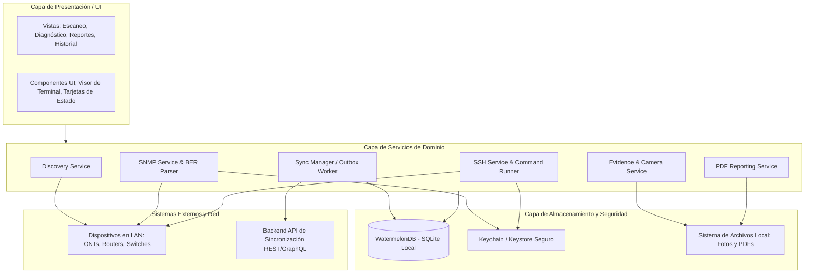
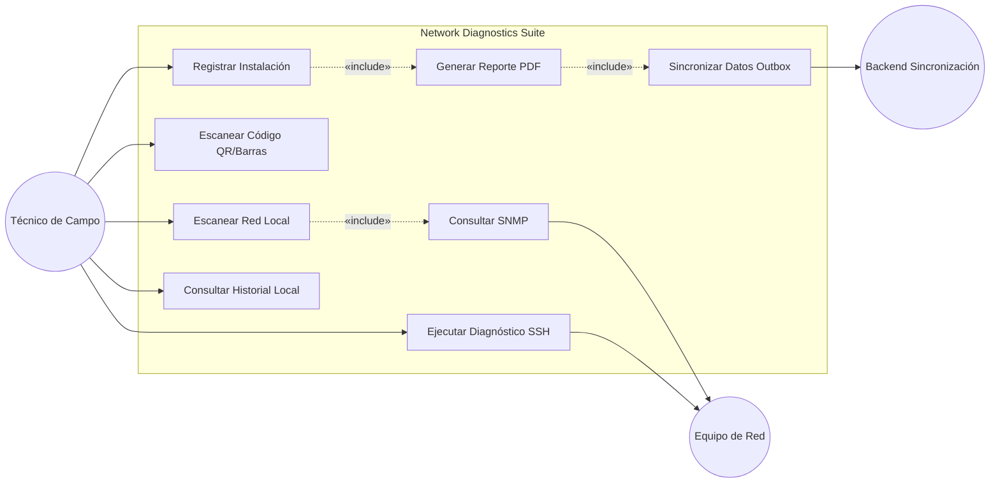
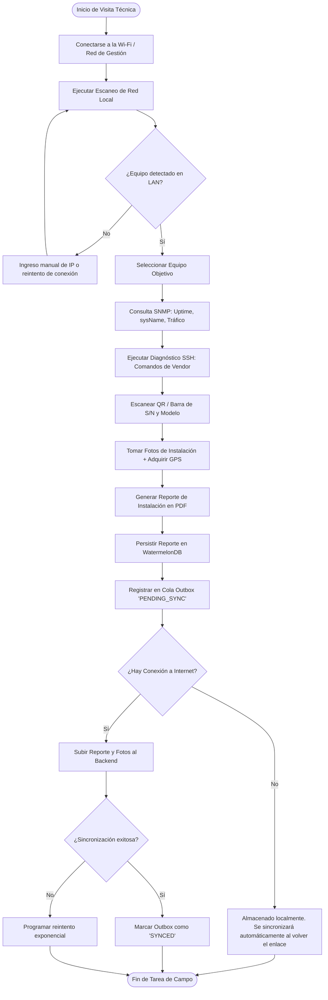

# INFORME DE REQUERIMIENTOS Y ESPECIFICACIÓN TÉCNICA
## Network Diagnostics Suite — Toolkit Móvil para Técnicos de Campo

**Asignatura:** Desarrollo de Aplicaciones Móviles (2026)  
**Carrera:** Licenciatura en Sistemas de Información  
**Área temática:** Comunicaciones y Redes de Datos  
**Tecnología Principal:** React Native (CLI Nativo / Bare Workflow)  
**Destinatario Técnico / Asistente:** Documento optimizado para ingesta y diseño por modelos de lenguaje (Claude / LLMs) y desarrolladores de software.

---

## 1. Resumen Ejecutivo y Contexto del Problema

### 1.1 Contexto Operativo
Los técnicos de telecomunicaciones realizan despliegues, auditorías y tareas de mantenimiento preventivo/correctivo sobre equipos de red (ONTs, Routers, Switches, Puntos de Acceso / Antenas inalámbricas) en entornos hostiles:
- Azoteas, gabinetes urbanos, salas de servidores o áreas rurales.
- **Conectividad nula o intermitente**: No se puede depender de conexión 4G/5G ni de salida a Internet a través de la infraestructura que se está auditando.
- La aplicación móvil debe actuar como una herramienta de diagnóstico local directa conectada a la LAN/WLAN del equipamiento, sin depender de intermediarios HTTP en la nube para operar en tiempo real.

### 1.2 Restricción Tecnológica Crítica (Protocolos de Bajo Nivel)
A diferencia de aplicaciones móviles tradicionales basadas en REST o GraphQL sobre HTTPS:
- Esta suite requiere interactuar directamente con sockets **TCP y UDP crudos**.
- Debe implementar un escaneo de red a nivel de enlace/red (mDNS / Zeroconf y sondeo ARP/ping local).
- Requiere construir y parsear manualmente paquetes de protocolo binario **SNMP (Simple Network Management Protocol v1/v2c)** bajo codificación BER (Basic Encoding Rules) / ASN.1 sobre el puerto UDP/161.
- Requiere un cliente **SSH embebido** para ejecutar comandos directos de consola sobre los sistemas operativos de red (ej. Cisco IOS, RouterOS MikroTik, OpenWrt, Huawei).

### 1.3 Entorno de Ejecución Móvil
- **Incompatibilidad con Expo Go**: Debido al requerimiento de módulos nativos de sockets (`react-native-udp`, `react-native-tcp-socket`), cliente SSH nativo (`react-native-ssh-sftp`) y acceso a hardware de cámara/sensores, el proyecto debe ser desarrollado exclusivamente bajo **React Native CLI (Bare Workflow)** o prebuild nativo con Android NDK / CocoaPods.
- **Dispositivo objetivo de pruebas**: Dispositivo físico Android (o emulador con bridging de red LAN) con Android SDK 26+ (Android 8.0 Oreo en adelante).

---

## 2. Objetivos del Sistema

### 2.1 Objetivo General
Desarrollar una aplicación móvil *offline-first* en React Native que brinde a los técnicos de campo capacidades de descubrimiento de red local, telemetría y consulta SNMP/SSH sobre equipamiento de telecomunicaciones, y generación de reportes de instalación georreferenciados con sincronización diferida.

### 2.2 Objetivos Específicos
1. **Descubrimiento LAN**: Detectar hosts activos en la subred local mediante mDNS/Bonjour y escaneo de puertos/sondeo UDP.
2. **Telemetría SNMP**: Consultar OIDs estándar MIB-II (uptime, sysName, ifDescr, ifOperStatus, tráfico de interfaces) mediante un parser BER/ASN.1 propio sobre UDP/161.
3. **Diagnóstico SSH**: Ejecutar sets de comandos preconfigurados y parsear su salida mediante sesión SSH segura.
4. **Identificación Óptica**: Capturar números de serie y modelos escaneando códigos QR/Barras mediante cámara y visión artificial.
5. **Reportes Documentales**: Generar un archivo PDF exportable con metadatos técnicos, fotos de evidencia y coordenadas GPS exactas.
6. **Arquitectura Offline-First**: Persistir todo evento y reporte en una base de datos reactiva local (WatermelonDB), gestionando una cola de salida (*outbox pattern*) para sincronización automática al restablecerse la conexión a Internet.

---

## 3. Requisitos Funcionales (RF)

| ID | Requisito Funcional | Prioridad | Entrada / Trigger | Procesamiento y Lógica | Salida / Efecto Colateral |
| :--- | :--- | :--- | :--- | :--- | :--- |
| **RF-01** | **Escaneo de Red Local (LAN Discovery)** | **Alta** | Técnico presiona "Escanear Red" conectado a la interfaz Wi-Fi de gestión del nodo. | Obtiene la IP local y máscara de subred vía interfaz de red. Realiza sondeo mDNS (`react-native-zeroconf`) y sondeo ICMP/UDP/TCP sobre el rango CIDR (ej. /24). Resuelve direcciones IP, MAC y hostname cuando sea factible. | Lista de dispositivos detectados (IP, MAC, Hostname, tiempo de respuesta). Posibilidad de seleccionar un dispositivo para diagnóstico. |
| **RF-02** | **Consulta de Telemetría vía SNMP** | **Alta** | Selección de dispositivo IP, puerto (def: 161) y comunidad SNMP (def: "public"). | Ensambla PDU `GetRequest` (v1/v2c) con OIDs MIB-II. Envía datagrama UDP a través de `react-native-udp`. Recibe y decodifica respuesta BER/ASN.1 (`GetResponse`). Extrae valores de tipos INTEGER, OCTET STRING, TimeTicks, Counter32/64. | Pantalla de estado con: Nombre del equipo (`sysName`), Tiempo de actividad (`sysUpTime`), Tabla de interfaces de red con estado operativo y contadores de tráfico. |
| **RF-03** | **Ejecución de Diagnósticos vía SSH** | **Alta** | Selección de IP, puerto SSH (22), credenciales (usuario/contraseña o llave privada) y perfil de comandos. | Recupera credenciales seguras (Keychain/Keystore). Establece túnel SSH usando `react-native-ssh-sftp`. Ejecuta comandos según vendor (ej. `show interfaces status`, `ip address print`, `ping 8.8.8.8 count 3`). Captura stdout/stderr. Cierra sesión. | Registro formateado de la consola con resaltado de sintaxis o tarjetas de resumen con estado de enlaces. |
| **RF-04** | **Escaneo y Asociación de QR / Código de Barras** | **Media** | Activación de la cámara desde la ficha de instalación o equipo. | Procesa el stream de video con `react-native-vision-camera`. Decodifica códigos QR, Code 128 o DataMatrix que contienen el Serial Number (S/N) o MAC del equipo. | Completa automáticamente los campos de identificación del equipo y busca ficha técnica o histórico asociado. |
| **RF-05** | **Registro de Instalación con Evidencia y GPS** | **Alta** | Formulario de "Nueva Instalación / Mantenimiento". | Captura fotos de la instalación (rack, conectores, empalme de fibra, potencia óptica). Consulta GPS en tiempo real con `react-native-geolocation-service` (latitud, longitud, altitud, precisión). Recolecta observaciones técnicas del operador. | Objeto de instalación persistido localmente con URIs de fotos, coordenadas geográficas, fecha/hora y firmas técnicas. |
| **RF-06** | **Generación de Reporte de Instalación en PDF** | **Media** | Acción "Finalizar y Generar Reporte PDF". | Consolida datos del cliente, nodo, ficha técnica, resultados de telemetría SNMP/SSH, fotos incrustadas y sello GPS. Renderiza template HTML dinámico y compila a PDF binario mediante `react-native-html-to-pdf`. | Archivo PDF local guardado en el sandbox de la app; opción de previsualizar, compartir vía Bluetooth/WhatsApp/AirDrop o guardar en almacenamiento. |
| **RF-07** | **Operación Offline y Cola de Sincronización (Outbox)** | **Alta** | Operación continua del técnico en áreas sin cobertura. | Almacena todas las operaciones de modificación (creación de reportes, diagnósticos, fotos) en base de datos local con estado `PENDING_SYNC`. Escucha cambios de conectividad con NetInfo. Al reconectar a una red con acceso a Internet, procesa la cola de forma transaccional hacia el backend. | Los ítems pasan a estado `SYNCED` con reintentos exponenciales y manejo de fallos si la conexión cae a medio camino. |
| **RF-08** | **Historial Local de Diagnósticos e Instalaciones** | **Media** | Navegación a la pestaña "Historial" / "Mis Nodos". | Consulta la base de datos local WatermelonDB indexada por fecha, MAC, Serial Number o Nombre del Sitio. Funciona 100% offline. | Listado filtrable y buscador de diagnósticos previos, permitiendo comparar métricas de tráfico o lecturas previas de un mismo equipo. |

---

## 4. Requisitos No Funcionales (RNF)

### 4.1 Rendimiento y Eficiencia de Recursos
- **RNF-01 (Tiempos de Escaneo LAN):** El escaneo de una subred `/24` (254 hosts) no debe exceder los 15 segundos para la fase mDNS y barrido básico UDP.
- **RNF-02 (Uso de Memoria y Rendimiento en Cámara):** La captura de fotos debe aplicar compresión y redimensionado antes del almacenamiento local para evitar desbordes de memoria (OutOfMemory) al compilar reportes PDF extensos con múltiples imágenes.
- **RNF-03 (Bajo Consumo de Batería):** El módulo de geolocalización debe solicitar coordenadas de alta precisión únicamente durante la captura de evidencia fotográfica o cierre de reporte, liberando el GPS inmediatamente después.

### 4.2 Seguridad y Protección de Credenciales
- **RNF-04 (Almacenamiento Seguro de Credenciales):** Las credenciales de acceso SSH (contraseñas de routers, llaves RSA/Ed25519) **bajo ninguna circunstancia** deben ser guardadas en texto plano, ni en AsyncStorage ni en bases de datos abiertas. Deben utilizar el hardware de seguridad del dispositivo:
  - Android: Android Keystore / EncryptedSharedPreferences (vía `react-native-keychain`).
  - iOS: Secure Enclave / Keychain Services.
- **RNF-05 (Aislamiento de Cadenas de Comunidad SNMP):** La comunidad SNMP por defecto ("public") debe poder ser sobrescrita por el operador y almacenada de forma protegida para no filtrar cadenas privadas de red.

### 4.3 Fiabilidad, Tolerancia a Fallos y Modo Offline
- **RNF-06 (Arquitectura Offline-First Estricta):** Toda funcionalidad de la app (excepto la subida final al backend de la nube) debe ser 100% operativa sin conectividad celular ni acceso a Internet.
- **RNF-07 (Patrón Outbox Idempotente):** Las peticiones enviadas al backend de sincronización deben contener UUIDs generados por el cliente para garantizar idempotencia en caso de reintentos por pérdida de señal.

### 4.4 Portabilidad y Compatibilidad
- **RNF-08 (Compatibilidad de Plataforma):** Diseñado primariamente para Android 8.0 (API Level 26) o superior, con soporte de permisos de red local (`ACCESS_FINE_LOCATION`, `ACCESS_WIFI_STATE`, `CHANGE_WIFI_MULTICAST_STATE`, `CAMERA`).

---

## 5. Especificaciones de Protocolos y Arquitectura de Red

### 5.1 Protocolo SNMP v1 / v2c (Parser ASN.1 / BER Propio)
Dado que no se utilizan librerías Node.js estándar incompatibles con el runtime móvil (Hermes/JSC), se implementa un cliente UDP ligero:
1. **Estructura del Datagrama UDP**:
   - Puerto de destino: `161`.
   - Tipo de PDU: `GetRequest` (Tag `0xA0`).
2. **OIDs Estándar de MIB-II a consultar**:
   - `1.3.6.1.2.1.1.1.0` (`sysDescr` - Descripción del sistema operativo y hardware).
   - `1.3.6.1.2.1.1.3.0` (`sysUpTime` - Tiempo de encendido en centésimas de segundo).
   - `1.3.6.1.2.1.1.5.0` (`sysName` - Nombre del nodo/host).
   - `1.3.6.1.2.1.2.2.1.2.x` (`ifDescr` - Nombres de interfaces: eth0, gpon0, wlan0).
   - `1.3.6.1.2.1.2.2.1.8.x` (`ifOperStatus` - Estado operativo: Up=1, Down=2).
   - `1.3.6.1.2.1.2.2.1.10.x` (`ifInOctets` - Bytes recibidos).
   - `1.3.6.1.2.1.2.2.1.16.x` (`ifOutOctets` - Bytes transmitidos).
3. **Decodificación BER (Basic Encoding Rules)**:
   - Tag / Length / Value (TLV).
   - Soporte de tipos primitivos ASN.1: Integer (`0x02`), Octet String (`0x04`), Null (`0x05`), Object Identifier (`0x06`), Sequence (`0x30`), TimeTicks (`0x43`), Counter32 (`0x41`).

### 5.2 Cliente SSH y Ejecución de Comandos
- **Autenticación**: Soporte para combinación Usuario/Password y LLave privada PEM/OpenSSH.
- **Flujo de Ejecución**:
  - Handshake y verificación de host fingerprint.
  - Apertura de canal de ejecución (*exec channel*).
  - Timeout de conexión configurable (default: 8 segundos).
  - Sanitización de buffers para evitar colgar la interfaz en salidas de consola masivas.

---

## 6. Stack Tecnológico Detallado

| Propósito | Librería / Módulo | Justificación Técnica |
| :--- | :--- | :--- |
| **Core Framework** | `react-native` (CLI) | Permite enlazar bibliotecas nativas de C++/Java requeridas para networking raw. |
| **Descubrimiento mDNS** | `react-native-zeroconf` | Descubrimiento de servicios `_ssh._tcp`, `_http._tcp`, `_workstation._tcp` en la LAN. |
| **Sockets UDP (SNMP)** | `react-native-udp` | Implementa la API standard `dgram` de Node.js sobre sockets BSD nativos móviles. |
| **Sockets TCP** | `react-native-tcp-socket` | Sondeo de puertos y conexiones directas de red. |
| **Cliente SSH** | `react-native-ssh-sftp` | Wrapper sobre libssh2 (iOS) y JSch / SSHJ (Android) para canales SSH remotos. |
| **Gestión de Claves** | `react-native-keychain` | Almacenamiento con cifrado de hardware para credenciales de red. |
| **Escáner y Cámara** | `react-native-vision-camera` | Framework moderno de alto rendimiento para captura y análisis de fotogramas (QR/Barcode). |
| **Geolocalización** | `react-native-geolocation-service` | Acceso a proveedores GPS de alta precisión con consumo eficiente. |
| **Base de Datos Local** | `@nozbe/watermelondb` | Base de datos SQLite reactiva optimizada para miles de registros y sincronización offline rápida. |
| **Monitoreo de Red** | `@react-native-community/netinfo` | Detección reactiva de conexión a Internet para disparar el worker de sincronización. |
| **Generación de Reportes** | `react-native-html-to-pdf` | Renderizado de documentos PDF estándar a partir de plantillas HTML/CSS locales. |

---

## 7. Arquitectura del Software

La solución adopta una **Arquitectura en Capas Limpia (Clean Layered Architecture)** desacoplando la interfaz de usuario de los protocolos binarios y de la persistencia:

### 7.1 Responsabilidad de las Capas
1. **Discovery Layer**: Abstrae el escaneo de IPs y servicios mDNS en la LAN.
2. **Protocol Layer**: Implementa la construcción de datagramas UDP para SNMP, el decodificador BER/ASN.1 y la sesión SSH.
3. **Evidence Layer**: Coordina la cámara, la lectura de códigos de barra/QR y la adquisición de coordenadas GPS.
4. **Local Store Layer**: Modela las entidades (Devices, Diagnostics, Reports, OutboxQueue) en WatermelonDB con migraciones y esquemas relacionales.
5. **Sync Layer**: Implementa el patrón Outbox. Escucha eventos de `NetInfo`. Cuando hay conectividad a Internet, extrae los registros pendientes de la cola, los serializa con sus adjuntos (fotos en Base64 o Multipart) y los envía al backend.
6. **Reporting Layer**: Compila los reportes de instalación a archivos PDF físicos.

---

## 8. Diagramas de Casos de Uso y Flujos de Operación

### 8.1 Diagrama de Casos de Uso

### 8.2 Diagrama de Flujo: Ciclo de Diagnóstico e Instalación (Ruta Offline-First)

---

## 9. Modelo de Datos Propuesto (WatermelonDB Schema)

### 9.1 Entidad `devices`
- `id` (string, UUID, primary key)
- `ip_address` (string)
- `mac_address` (string, nullable)
- `hostname` (string, nullable)
- `serial_number` (string, indexado, nullable)
- `vendor` (string, nullable)
- `model` (string, nullable)
- `created_at` (number, timestamp)

### 9.2 Entidad `diagnostics`
- `id` (string, UUID, primary key)
- `device_id` (string, foreign key -> devices.id)
- `snmp_sys_name` (string, nullable)
- `snmp_uptime` (string, nullable)
- `snmp_interfaces_data` (string, JSON serializado)
- `ssh_commands_output` (string, text/log)
- `created_at` (number, timestamp)

### 9.3 Entidad `installations`
- `id` (string, UUID, primary key)
- `site_name` (string)
- `device_id` (string, foreign key -> devices.id)
- `latitude` (number)
- `longitude` (number)
- `altitude` (number, nullable)
- `accuracy` (number)
- `technician_notes` (string)
- `pdf_local_path` (string)
- `created_at` (number, timestamp)

### 9.4 Entidad `evidence_photos`
- `id` (string, UUID, primary key)
- `installation_id` (string, foreign key -> installations.id)
- `photo_local_uri` (string)
- `photo_type` (string: "RACK", "OPTICAL_POWER", "SERIAL_LABEL", "ENVIRONMENT")
- `created_at` (number, timestamp)

### 9.5 Entidad `outbox_sync_queue`
- `id` (string, UUID, primary key)
- `entity_type` (string: "INSTALLATION", "DIAGNOSTIC")
- `entity_id` (string)
- `payload` (string, JSON)
- `sync_status` (string: "PENDING", "IN_PROGRESS", "FAILED", "SYNCED")
- `retry_count` (number, default: 0)
- `last_error` (string, nullable)
- `created_at` (number, timestamp)
- `updated_at` (number, timestamp)

---

## 10. Consideraciones de Implementación Críticas para el Agente / Desarrollador

1. **Permisos en Android (`AndroidManifest.xml`)**:
   - `android.permission.INTERNET`
   - `android.permission.ACCESS_NETWORK_STATE`
   - `android.permission.ACCESS_WIFI_STATE`
   - `android.permission.CHANGE_WIFI_MULTICAST_STATE` (indispensable para mDNS/Zeroconf).
   - `android.permission.ACCESS_FINE_LOCATION` y `ACCESS_COARSE_LOCATION` (GPS).
   - `android.permission.CAMERA` (QR y fotos).
2. **Entorno de Red y Testing en Desarrollo**:
   - Para probar sockets UDP y escaneo de LAN, las pruebas en dispositivo físico conectado a la misma red Wi-Fi que un router de laboratorio o un simulador SNMP en la PC local son altamente recomendables frente a un emulador con NAT aislado.
   - En emulador Android, `10.0.2.2` apunta al host de desarrollo. Se pueden usar herramientas como `snmpsim` o un servidor `snmpd` local en la máquina anfitriona para testear el parser de OIDs.
3. **Manejo de Errores y Timeouts en Sockets**:
   - Los sockets UDP no tienen confirmación de entrega (orientados a datagrama). El cliente SNMP debe implementar un mecanismo de timeout (ej. 3 segundos) con reintentos configurables si no se recibe `GetResponse`.
4. **Backend Mínimo de Sincronización (Stub)**:
   - Para validar el flujo end-to-end del entregable, se proveerá un backend ligero (Node.js/Express, Fastify o Python FastAPI) con endpoints:
     - `POST /api/v1/sync/installations`
     - `GET /api/v1/sync/health`

---

## 11. Entregables del Proyecto

1. **Código Fuente Completo**: Repositorio Git estructurado, modularizado y documentado.
2. **Build de Prueba (APK compilado)**: Versión instalable para Android validando funcionamiento fuera de Expo Go.
3. **Documento Técnico de Arquitectura**: Especificación detallada del subset SNMP BER implementado, mecanismos de seguridad de credenciales (Keychain) y máquina de estados de la cola Outbox.
4. **Backend Stub de Sincronización**: Servidor ligero para recibir los payloads encolados y validar el comportamiento reactivo online/offline.
5. **Video Demostración**: Demostración en video con dispositivo real operando en LAN, consulta SNMP, captura con GPS/fotos, generación de PDF y sincronización al restaurar el acceso a Internet.
