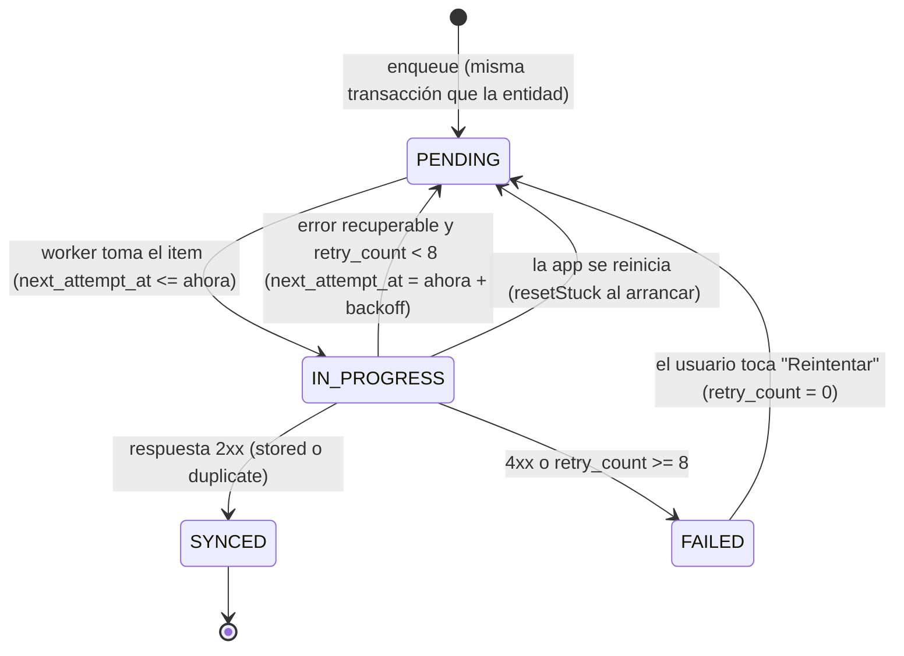

# PLAN DE IMPLEMENTACIÓN — Network Diagnostics Suite

> **Documento fuente:** [INFORME_REQUERIMIENTOS.md](./INFORME_REQUERIMIENTOS.md)
> **Guía visual:** [GUIA_ESTILOS.md](./GUIA_ESTILOS.md)
> **Objetivo de este documento:** que un desarrollador o un agente (Claude) pueda implementar la app **de principio a fin sin tener que tomar decisiones de diseño**. Toda decisión está cerrada aquí. Si algo no está especificado, aplicar la regla de la sección 0.3.

---

## 0. Reglas de este plan

### 0.1 Cómo leer el plan
- Las fases (sección 5) se ejecutan **en orden estricto**. No se empieza la fase N+1 sin cumplir **todos** los criterios de aceptación (CA) de la fase N.
- Cada tarea indica: **archivos exactos**, **qué implementar** y **cómo verificar**.
- Las palabras **DEBE / NO DEBE** son obligatorias. **PUEDE** es opcional.

### 0.2 Correcciones técnicas al informe de requerimientos
El informe contiene supuestos que no se pueden cumplir en Android sin root. Este plan los resuelve así (estas decisiones **prevalecen** sobre el informe):

| # | Supuesto del informe | Realidad técnica | Decisión cerrada |
|---|---|---|---|
| C1 | "Sondeo ARP/ping local" | Android no permite ICMP crudo ni leer `/proc/net/arp` desde Android 10 (API 29). | El descubrimiento usa **sondeo TCP connect** + **sondeo SNMP UDP** + **mDNS**. Un host está "vivo" si un puerto acepta la conexión **o la rechaza** (`ECONNREFUSED`). |
| C2 | "Resolver MAC de los hosts" | No se puede obtener la MAC de otros hosts sin ARP. | `mac_address` es **opcional**. Se completa sólo vía SNMP (`ifPhysAddress`, OID `1.3.6.1.2.1.2.2.1.6`) o vía escaneo de QR. |
| C3 | Escaneo de "rango CIDR" genérico | Una /16 son 65.534 hosts: inviable en 15 s. | Si el prefijo es menor a /24, se escanea **sólo la /24 que contiene la IP del teléfono**. Se muestra un aviso. |
| C4 | Counter64 en SNMP v1 | Counter64 sólo existe en v2c. | Por defecto se usa **v2c**. Si falla por timeout, se reintenta **una vez** en v1. |
| C5 | Soporte iOS | No es requisito de entrega (APK). | **Sólo Android.** El código NO DEBE usar APIs exclusivas de iOS, pero no se configura ni se prueba iOS. |
| C6 | Autenticación SSH por llave privada | Aumenta mucho el alcance (importar archivos PEM). | **Alcance v1: sólo usuario + contraseña.** La llave privada queda como mejora futura (sección 11). |

### 0.3 Regla ante ambigüedad
Si aparece un caso no cubierto: (1) elegir la opción **más simple** que cumpla el requerimiento, (2) documentarla en `docs/DECISIONES.md` con fecha y motivo, (3) continuar. NO DEBE agregarse ninguna librería que no figure en la sección 2 sin registrarla en ese archivo.

---

## 1. Entorno de desarrollo (Windows)

| Herramienta | Versión | Verificación |
|---|---|---|
| Node.js | 20 LTS | `node -v` → `v20.x` |
| npm | El que trae Node 20 | `npm -v` |
| JDK | 17 (Temurin o el que trae Android Studio) | `java -version` → `17` |
| Android Studio | Última estable | SDK Platform 34 y 35, Build-Tools, Platform-Tools, NDK (side by side) |
| Variables de entorno | `ANDROID_HOME=%LOCALAPPDATA%\Android\Sdk`; agregar `%ANDROID_HOME%\platform-tools` al `PATH` | `adb version` |
| Dispositivo | Android físico 8.0+ con depuración USB | `adb devices` lo lista |
| Git | Cualquiera reciente | `git --version` |

**Herramientas de prueba de red** (en la PC de desarrollo):
- `snmpsim` (Python): `pip install snmpsim` → simula un agente SNMP con datos MIB-II reales.
- Un servidor SSH: **OpenSSH Server** de Windows (Configuración → Aplicaciones → Características opcionales) o un router de laboratorio (MikroTik/OpenWrt).

---

## 2. Stack cerrado (librerías y propósito)

> Instalar **exactamente** estas librerías. Las versiones se fijan con `package-lock.json` en la Fase 0. Si una librería no compila, aplicar el **fallback** indicado; no buscar otra.

| Capa | Paquete | Uso | Fallback si no compila |
|---|---|---|---|
| Base | `react-native` (CLI, última estable) + TypeScript | App | — |
| Navegación | `@react-navigation/native`, `@react-navigation/native-stack`, `@react-navigation/bottom-tabs`, `react-native-screens`, `react-native-safe-area-context` | Navegación | — |
| Estado efímero | `zustand` | Estado de UI y sesiones de escaneo | — |
| Formularios | `react-hook-form`, `zod`, `@hookform/resolvers` | Validación | — |
| BD local | `@nozbe/watermelondb` + `@babel/plugin-proposal-decorators` | Persistencia offline | Desactivar JSI (`jsi: false`) |
| Red: UDP | `react-native-udp` | SNMP | Poner `newArchEnabled=false` en `android/gradle.properties` |
| Red: TCP | `react-native-tcp-socket` | Sondeo de puertos | Ídem |
| mDNS | `react-native-zeroconf` | Descubrimiento de servicios | Desactivar la función mDNS (el escaneo TCP/SNMP sigue funcionando) y registrarlo |
| Estado de red | `@react-native-community/netinfo` | IP/subred y conectividad | — |
| SSH | `@dylankenneally/react-native-ssh-sftp` | Cliente SSH | `react-native-ssh-sftp` (paquete original) |
| Credenciales | `react-native-keychain` | Almacenamiento seguro | — |
| Permisos | `react-native-permissions` | Solicitud de permisos en tiempo de ejecución | — |
| Cámara/QR | `react-native-vision-camera` (v4, `useCodeScanner`) | Fotos y códigos | — |
| Redimensionar imágenes | `@bam.tech/react-native-image-resizer` | Compresión de fotos | — |
| GPS | `react-native-geolocation-service` | Coordenadas | — |
| Archivos | `@dr.pogodin/react-native-fs` | Mover fotos y PDF, leer base64 | — |
| PDF | `react-native-html-to-pdf` | Generar reportes | — |
| Compartir | `react-native-share` | Compartir PDF | — |
| Visor PDF | Abrir con app externa vía `react-native-share` / Intent | Previsualizar | — |
| UUID | `uuid` + `react-native-get-random-values` | IDs del cliente | — |
| Bytes | `buffer` | Codificación BER | — |
| Íconos | `lucide-react-native` + `react-native-svg` | Iconografía | — |
| Alias de rutas | `babel-plugin-module-resolver` | `@/` → `src/` | — |
| Tests | `jest` (incluido), `@testing-library/react-native` | Pruebas unitarias y de componentes | — |
| Backend stub | `express`, `cors`, `better-sqlite3` (en `/backend`) | Recepción de la sincronización | Guardar en archivo JSON |

**Prohibido:** Expo Go, `AsyncStorage` para credenciales, librerías Node (`net-snmp`, `ssh2`) que dependan de módulos nativos de Node.

---

## 3. Estructura del repositorio (exacta)

```
trabajo 6/
├── CLAUDE.md
├── README.md
├── INFORME_REQUERIMIENTOS.md
├── PLAN_IMPLEMENTACION.md
├── GUIA_ESTILOS.md
├── docs/
│   ├── DECISIONES.md
│   ├── ARQUITECTURA.md            (entregable 3, se escribe en Fase 10)
│   └── PROGRESO.md                (checklist de fases, se actualiza al cerrar cada una)
├── backend/
│   ├── package.json
│   ├── src/server.js
│   └── data/                      (sync.db, se ignora en git)
└── app/                           (proyecto React Native)
    ├── android/
    ├── index.js
    ├── babel.config.js
    ├── tsconfig.json
    ├── .env.example               (SYNC_BASE_URL)
    ├── __tests__/
    │   ├── snmp/ber.test.ts
    │   ├── snmp/client.test.ts
    │   ├── discovery/subnet.test.ts
    │   ├── ssh/profiles.test.ts
    │   ├── sync/backoff.test.ts
    │   └── report/template.test.ts
    └── src/
        ├── App.tsx
        ├── config/
        │   ├── constants.ts       (timeouts, puertos, límites)
        │   └── env.ts
        ├── theme/                 (ver GUIA_ESTILOS.md)
        │   ├── tokens.ts
        │   ├── ThemeProvider.tsx
        │   └── useTheme.ts
        ├── components/
        │   ├── ui/                (Button, Input, Card, ListRow, Badge, Text, Divider, EmptyState, Toast, Sheet, Screen)
        │   ├── TerminalView.tsx
        │   ├── InterfaceRow.tsx
        │   ├── SyncIndicator.tsx
        │   └── PhotoGrid.tsx
        ├── navigation/
        │   ├── RootNavigator.tsx
        │   ├── TabsNavigator.tsx
        │   └── types.ts
        ├── screens/
        │   ├── network/ScanScreen.tsx
        │   ├── network/ManualHostScreen.tsx
        │   ├── device/DeviceScreen.tsx
        │   ├── device/SnmpScreen.tsx
        │   ├── device/SshScreen.tsx
        │   ├── device/CredentialsScreen.tsx
        │   ├── installation/InstallationFormScreen.tsx
        │   ├── installation/CameraScreen.tsx
        │   ├── installation/CodeScannerScreen.tsx
        │   ├── installation/ReportPreviewScreen.tsx
        │   ├── history/HistoryScreen.tsx
        │   ├── history/HistoryDetailScreen.tsx
        │   └── settings/SettingsScreen.tsx
        ├── services/
        │   ├── discovery/
        │   │   ├── subnet.ts
        │   │   ├── tcpProbe.ts
        │   │   ├── mdns.ts
        │   │   └── DiscoveryService.ts
        │   ├── snmp/
        │   │   ├── ber.ts
        │   │   ├── oids.ts
        │   │   ├── pdu.ts
        │   │   └── SnmpClient.ts
        │   ├── ssh/
        │   │   ├── profiles.ts
        │   │   └── SshService.ts
        │   ├── security/CredentialStore.ts
        │   ├── permissions/PermissionService.ts
        │   ├── evidence/
        │   │   ├── PhotoService.ts
        │   │   └── LocationService.ts
        │   ├── report/
        │   │   ├── template.ts
        │   │   └── ReportService.ts
        │   └── sync/
        │       ├── backoff.ts
        │       ├── SyncApi.ts
        │       └── SyncManager.ts
        ├── db/
        │   ├── schema.ts
        │   ├── migrations.ts
        │   ├── index.ts
        │   ├── models/ (Device.ts, Diagnostic.ts, Installation.ts, EvidencePhoto.ts, OutboxItem.ts)
        │   └── repositories/ (devices.ts, diagnostics.ts, installations.ts, outbox.ts)
        ├── store/
        │   ├── scanStore.ts
        │   └── settingsStore.ts
        ├── types/
        │   └── domain.ts
        └── utils/
            ├── format.ts          (bytes, uptime, fechas)
            ├── errors.ts
            └── logger.ts
```

---

## 4. Convenciones de código

- **TypeScript `strict: true`**. Prohibido `any` (usar `unknown` + validación).
- Componentes: `PascalCase.tsx`, una exportación por archivo. Servicios: clases o módulos en `PascalCase.ts`; utilidades en `camelCase.ts`.
- Imports con alias `@/` (ej. `import { SnmpClient } from '@/services/snmp/SnmpClient'`).
- **Las pantallas NO DEBEN** importar `react-native-udp`, `react-native-tcp-socket`, SSH, keychain ni WatermelonDB directamente. Sólo usan `services/`, `db/repositories/` y `store/`.
- Errores: todo servicio lanza `AppError` (`utils/errors.ts`) con `code` de este conjunto:
  `TIMEOUT | NETWORK_UNREACHABLE | AUTH_FAILED | PERMISSION_DENIED | PARSE_ERROR | SNMP_ERROR | NOT_FOUND | STORAGE_ERROR | UNKNOWN`.
  La UI traduce `code` a un mensaje en español con un único mapa (`utils/errors.ts → userMessage(code)`).
- Textos de UI: en español rioplatense con voseo consistente (ver GUIA_ESTILOS §9).
- Commits: Conventional Commits (`feat:`, `fix:`, `test:`, `docs:`, `chore:`). Una rama por fase: `fase-03-discovery`.
- Logs: `utils/logger.ts` con `debug/info/warn/error`; en release sólo `warn` y `error`. **Nunca** se loguean contraseñas ni comunidades SNMP.

### 4.1 Constantes (`src/config/constants.ts`) — valores obligatorios

```ts
export const DISCOVERY = {
  PROBE_PORTS: [22, 80, 443, 23, 8291, 8080, 8443],
  TCP_TIMEOUT_MS: 400,
  CONCURRENCY: 32,
  MDNS_DURATION_MS: 5000,
  MDNS_SERVICES: ['ssh', 'http', 'workstation', 'snmp'],
  MAX_PREFIX_SCAN: 24,
  TOTAL_BUDGET_MS: 15000,
} as const;

export const SNMP = {
  PORT: 161,
  DEFAULT_COMMUNITY: 'public',
  TIMEOUT_MS: 2000,
  RETRIES: 2,
  MAX_INTERFACES: 64,
  PROBE_TIMEOUT_MS: 600, // sondeo durante el discovery
} as const;

export const SSH = {
  PORT: 22,
  CONNECT_TIMEOUT_MS: 8000,
  COMMAND_TIMEOUT_MS: 15000,
  MAX_OUTPUT_BYTES: 256 * 1024,
} as const;

export const PHOTO = {
  MAX_SIDE_PX: 1600,
  JPEG_QUALITY: 70,
  MAX_PER_INSTALLATION: 12,
} as const;

export const GPS = {
  TIMEOUT_MS: 15000,
  MAX_AGE_MS: 10000,
  ACCEPTABLE_ACCURACY_M: 30,
} as const;

export const SYNC = {
  BASE_DELAY_MS: 5000,
  MAX_DELAY_MS: 30 * 60 * 1000,
  MAX_RETRIES: 8,
  REQUEST_TIMEOUT_MS: 30000,
  BATCH_SIZE: 5,
} as const;
```

---

## 5. Fases de implementación

Resumen:

| Fase | Nombre | RF / RNF cubiertos | Duración estimada |
|---|---|---|---|
| 0 | Bootstrap y validación de módulos nativos | RNF-08 | 2 días |
| 1 | Sistema de diseño y navegación | — | 2 días |
| 2 | Persistencia local (WatermelonDB) | RF-08 (base), RNF-06 | 2 días |
| 3 | Descubrimiento LAN | RF-01, RNF-01 | 3 días |
| 4 | Cliente SNMP + codec BER | RF-02, RNF-05 | 4 días |
| 5 | Credenciales seguras + SSH | RF-03, RNF-04 | 3 días |
| 6 | Cámara, QR, fotos y GPS | RF-04, RF-05, RNF-02, RNF-03 | 3 días |
| 7 | Instalación y reporte PDF | RF-05, RF-06 | 3 días |
| 8 | Backend stub y sincronización outbox | RF-07, RNF-07 | 3 días |
| 9 | Historial | RF-08 | 2 días |
| 10 | QA, APK release, documentación y demo | Entregables | 3 días |

---

### FASE 0 — Bootstrap y validación de módulos nativos

**Objetivo:** proyecto que compila en un dispositivo físico con **todos** los módulos nativos instalados. Esta fase existe para descubrir incompatibilidades al principio, no al final.

**Tareas**
1. Ver opciones del CLI y crear el proyecto:
   ```powershell
   npx @react-native-community/cli@latest init --help
   npx @react-native-community/cli@latest init NetDiagSuite --directory app --skip-git-init --pm npm
   ```
   Package name Android: `com.netdiagsuite`. Nombre visible: **NetDiag**.
2. Inicializar git en la raíz `trabajo 6/` con `.gitignore` que incluya `node_modules/`, `app/android/app/build/`, `app/android/.gradle/`, `backend/data/`, `.env`.
3. Instalar todas las dependencias de la sección 2 (`npm install ...` dentro de `app/`).
4. Configurar `babel.config.js`:
   ```js
   module.exports = {
     presets: ['module:@react-native/babel-preset'],
     plugins: [
       ['@babel/plugin-proposal-decorators', { legacy: true }],
       ['module-resolver', { root: ['./src'], alias: { '@': './src' } }],
     ],
   };
   ```
   (En v1 **no** se usa `react-native-reanimated`.)
5. `tsconfig.json`: `"strict": true`, `"experimentalDecorators": true`, `"paths": { "@/*": ["src/*"] }`, `"baseUrl": "."`.
6. `index.js`: primera línea `import 'react-native-get-random-values';`.
7. `AndroidManifest.xml` (`app/android/app/src/main/`): agregar
   ```xml
   <uses-permission android:name="android.permission.INTERNET" />
   <uses-permission android:name="android.permission.ACCESS_NETWORK_STATE" />
   <uses-permission android:name="android.permission.ACCESS_WIFI_STATE" />
   <uses-permission android:name="android.permission.CHANGE_WIFI_MULTICAST_STATE" />
   <uses-permission android:name="android.permission.ACCESS_FINE_LOCATION" />
   <uses-permission android:name="android.permission.ACCESS_COARSE_LOCATION" />
   <uses-permission android:name="android.permission.CAMERA" />
   ```
   y en `<application>`: `android:usesCleartextTraffic="true"` (el backend stub corre en HTTP dentro de la LAN).
8. `android/build.gradle`: `minSdkVersion = 26`.
9. Seguir las guías oficiales de instalación Android de: WatermelonDB, Vision Camera, react-native-permissions (declarar `CAMERA` y `LOCATION_WHEN_IN_USE` en el setup de Android) y Zeroconf.
10. Crear una pantalla temporal `src/dev/NativeSmokeTest.tsx` que, al tocar un botón por módulo, ejecute una llamada trivial:
    - UDP: crear socket, `bind(0)`, cerrar.
    - TCP: conectar a `8.8.8.8:53` con timeout 2 s.
    - Zeroconf: `scan('http','tcp','local.')` 2 s y `stop()`.
    - Keychain: guardar y leer `smoke/smoke`.
    - Vision Camera: `Camera.getCameraPermissionStatus()`.
    - WatermelonDB: crear y leer un registro en una tabla `smoke`.
    - NetInfo: imprimir `details.ipAddress` y `details.subnet`.
    - SSH: `SSHClient.connectWithPassword` contra el servidor de prueba y `execute('echo ok')`.
    - PDF: generar `<h1>ok</h1>` y mostrar la ruta.
11. Crear `docs/DECISIONES.md` y `docs/PROGRESO.md`.

**Criterios de aceptación**
- [ ] `npx react-native run-android` instala y abre la app en un **dispositivo físico**.
- [ ] Los 9 botones de la smoke test dan resultado OK (o se aplicó y documentó el fallback).
- [ ] `npx tsc --noEmit` sin errores. `npm test` pasa (test por defecto).
- [ ] Al cerrar la fase se **borra** `src/dev/` y la tabla `smoke`.

---

### FASE 1 — Sistema de diseño y navegación

**Objetivo:** componentes base y esqueleto navegable con todas las pantallas vacías.

**Tareas**
1. Implementar `src/theme/tokens.ts`, `ThemeProvider.tsx` y `useTheme.ts` **exactamente** como define GUIA_ESTILOS §2–§6.
2. Cargar fuentes Inter (400/500/600) y JetBrains Mono (400) como assets en `app/assets/fonts/` + `react-native.config.js` (`assets: ['./assets/fonts']`) + `npx react-native-asset`.
3. Implementar en `components/ui/`: `Text`, `Button`, `Input`, `Card`, `ListRow`, `Badge`, `Divider`, `EmptyState`, `Toast` (con un `ToastProvider` + hook `useToast`), `Sheet` (modal inferior), `Screen` (contenedor con safe area, padding y título). Especificación visual en GUIA_ESTILOS §7.
4. Navegación:
   - `TabsNavigator`: 3 pestañas — **Red** (`ScanScreen`), **Historial** (`HistoryScreen`), **Ajustes** (`SettingsScreen`).
   - `RootNavigator` (native-stack) contiene `Tabs` + `ManualHost`, `Device`, `Snmp`, `Ssh`, `Credentials`, `InstallationForm`, `Camera` (modal a pantalla completa), `CodeScanner` (modal), `ReportPreview`, `HistoryDetail`.
   - Tipos de parámetros en `navigation/types.ts`:
     ```ts
     export type RootStackParamList = {
       Tabs: undefined;
       ManualHost: undefined;
       Device: { deviceId: string };
       Snmp: { deviceId: string };
       Ssh: { deviceId: string };
       Credentials: { deviceId: string };
       InstallationForm: { deviceId: string; installationId?: string };
       Camera: { installationId: string };
       CodeScanner: { deviceId: string };
       ReportPreview: { installationId: string };
       HistoryDetail: { kind: 'installation' | 'diagnostic'; id: string };
     };
     ```
5. `SettingsScreen` con: tema (Sistema / Claro / Oscuro), comunidad SNMP por defecto, URL del backend de sincronización, versión de la app. Persistir preferencias no sensibles en la tabla `settings` (Fase 2); hasta entonces, en memoria con `settingsStore`.

**Criterios de aceptación**
- [ ] Se navega a todas las pantallas (vacías con título) sin errores.
- [ ] El cambio de tema claro/oscuro se aplica en caliente.
- [ ] Test de snapshot de `Button` (3 variantes) y `Badge` (4 estados).

---

### FASE 2 — Persistencia local (WatermelonDB)

**Objetivo:** esquema, modelos y repositorios listos.

**Tareas**
1. `db/schema.ts` (versión 1). Tablas y columnas — **los nombres son definitivos**:

   | Tabla | Columnas (tipo) | Índices |
   |---|---|---|
   | `devices` | `ip_address` (string), `mac_address` (string, opcional), `hostname` (string, opcional), `serial_number` (string, opcional), `vendor` (string, opcional), `model` (string, opcional), `open_ports` (string — JSON `number[]`), `discovery_source` (string: `tcp`\|`mdns`\|`snmp`\|`manual`), `last_seen_at` (number), `created_at` (number), `updated_at` (number) | `ip_address`, `serial_number` |
   | `diagnostics` | `device_id` (string), `kind` (string: `snmp`\|`ssh`), `snmp_sys_name`, `snmp_sys_descr`, `snmp_uptime_ticks` (number, opcional), `snmp_interfaces_json` (string, opcional), `ssh_profile` (string, opcional), `ssh_output` (string, opcional), `success` (boolean), `error_code` (string, opcional), `created_at` (number) | `device_id`, `created_at` |
   | `installations` | `device_id`, `site_name`, `client_name` (string), `latitude` (number, opcional), `longitude` (number, opcional), `altitude` (number, opcional), `accuracy` (number, opcional), `technician_name` (string), `technician_notes` (string), `diagnostic_ids_json` (string — JSON `string[]`), `pdf_local_path` (string, opcional), `status` (string: `draft`\|`finalized`), `created_at`, `updated_at` | `device_id`, `created_at`, `status` |
   | `evidence_photos` | `installation_id`, `photo_local_uri`, `photo_type` (string: `RACK`\|`OPTICAL_POWER`\|`SERIAL_LABEL`\|`ENVIRONMENT`), `width` (number), `height` (number), `created_at` | `installation_id` |
   | `outbox` | `entity_type` (string: `INSTALLATION`\|`DIAGNOSTIC`), `entity_id`, `payload_json` (string), `sync_status` (string: `PENDING`\|`IN_PROGRESS`\|`FAILED`\|`SYNCED`), `retry_count` (number), `next_attempt_at` (number), `last_error` (string, opcional), `created_at`, `updated_at` | `sync_status`, `next_attempt_at` |
   | `settings` | `key` (string), `value` (string) | `key` |

   > Diferencia con el informe: se agregan `kind`, `success`, `error_code`, `open_ports`, `status`, `client_name`, `technician_name` y `next_attempt_at`, necesarios para los flujos. La tabla se llama `outbox` (no `outbox_sync_queue`) por brevedad.

2. IDs: WatermelonDB genera IDs propios; **se reemplazan por UUID v4** configurando `setGenerator(() => uuidv4())` de `@nozbe/watermelondb/utils/common/randomId` en `db/index.ts`. Este UUID es la clave de idempotencia (RNF-07).
3. Modelos en `db/models/` con decoradores `@field`, `@text`, `@date`, `@readonly`, `@relation`, `@children`.
4. Repositorios (`db/repositories/`): cada uno expone funciones puras async; **todas las escrituras dentro de `database.write`**. Funciones mínimas:
   - `devices`: `upsertByIp(data)`, `getById(id)`, `observeAll()`, `updateIdentity(id, {serial, mac, model, vendor})`.
   - `diagnostics`: `create(data)`, `listByDevice(deviceId)`, `observeRecent(limit)`.
   - `installations`: `createDraft(deviceId)`, `update(id, patch)`, `finalize(id, pdfPath)`, `observeAll(filter)`.
   - `outbox`: `enqueue(entityType, entityId, payload)` (**en la misma transacción** que la escritura de la entidad), `takeDue(now, limit)`, `markInProgress`, `markSynced`, `markFailed(id, error)`, `resetStuck()`, `observeCounts()`.
5. `migrations.ts` con `schemaMigrations({ migrations: [] })` preparado para la v2.

**Criterios de aceptación**
- [ ] Test (con adaptador LokiJS en Jest) que crea un device, un diagnóstico y una instalación con su item de outbox en una sola transacción.
- [ ] Al reiniciar la app, los datos persisten.

---

### FASE 3 — Descubrimiento LAN (RF-01)

**Objetivo:** listar hosts vivos de la /24 en ≤ 15 s.

**Tareas**
1. `services/discovery/subnet.ts` — funciones puras:
   - `ipToInt(ip)`, `intToIp(n)`, `maskToPrefix(mask)`.
   - `hostsToScan(ip, mask): string[]` → si el prefijo < 24, usar /24 (regla C3); excluir dirección de red, broadcast y la IP propia.
2. `services/discovery/tcpProbe.ts` — `probeHost(ip): Promise<{alive: boolean; openPorts: number[]; rttMs?: number}>`:
   - Intenta en **paralelo** los `PROBE_PORTS` con `TCP_TIMEOUT_MS`.
   - Puerto que conecta → `openPorts` y `alive = true`.
   - Error `ECONNREFUSED` → `alive = true` (el host existe).
   - Timeout o `EHOSTUNREACH` → no cuenta.
   - `rttMs` = tiempo de la primera respuesta (conexión o rechazo).
   - **Siempre** destruir el socket (`destroy()`) al terminar o al vencer el timeout.
3. Sondeo SNMP en el discovery: para cada host **no vivo por TCP**, enviar un `GetRequest sysName` con `PROBE_TIMEOUT_MS` y sin reintentos (usa el `SnmpClient` de la Fase 4; **en esta fase dejar el hook vacío** y activarlo al cerrar la Fase 4).
4. `services/discovery/mdns.ts` — envuelve `react-native-zeroconf`: escanea `MDNS_SERVICES` durante `MDNS_DURATION_MS`, devuelve `{ip, hostname, service}[]`. Llamar a `stop()` y `removeDeviceListeners()` siempre.
5. `services/discovery/DiscoveryService.ts`:
   ```ts
   export interface DiscoveredHost {
     ip: string; hostname?: string; openPorts: number[];
     rttMs?: number; sources: Array<'tcp' | 'mdns' | 'snmp'>;
   }
   export interface ScanProgress { scanned: number; total: number; found: number; }
   export interface DiscoveryService {
     getLocalNetwork(): Promise<{ ip: string; mask: string; prefix: number; ssid?: string }>;
     scan(onHost: (h: DiscoveredHost) => void, onProgress: (p: ScanProgress) => void,
          signal: AbortSignal): Promise<DiscoveredHost[]>;
   }
   ```
   - `getLocalNetwork` usa `NetInfo.fetch()`; si `type !== 'wifi'` o falta `ipAddress`/`subnet`, lanza `AppError('NETWORK_UNREACHABLE')`.
   - `scan` corre mDNS y TCP **en paralelo**; TCP con un pool de `CONCURRENCY` promesas. Fusiona resultados por IP. Respeta `signal` (botón "Detener") y `TOTAL_BUDGET_MS`.
   - Al terminar, `devices.upsertByIp` para cada host (actualiza `last_seen_at`).
6. `store/scanStore.ts` (zustand): `status: 'idle'|'scanning'|'done'|'error'`, `hosts`, `progress`, `error`, `start()`, `stop()`.
7. `ScanScreen`: estructura definida en GUIA_ESTILOS §8.1. Al tocar un host → `Device`.
8. `ManualHostScreen`: campo IP validado con zod (regex IPv4) → `upsertByIp({discovery_source:'manual'})` → `Device`.
9. Permisos: antes de escanear, `PermissionService.ensure('location')` (requerido por Android para leer el SSID y la información de Wi-Fi).

**Criterios de aceptación**
- [ ] `subnet.test.ts`: `hostsToScan('192.168.1.37','255.255.255.0')` devuelve 253 IPs, sin `.0`, `.255` ni `.37`; con máscara `255.255.0.0` devuelve la misma /24.
- [ ] En una red doméstica real, detecta el router y la PC de desarrollo en < 15 s.
- [ ] "Detener" corta el escaneo en < 1 s y no quedan sockets abiertos (verificar con logs).
- [ ] Sin Wi-Fi: se muestra el estado vacío "Conectate a una red Wi-Fi" (GUIA §9) en lugar de un error genérico.

---

### FASE 4 — Cliente SNMP y codec BER (RF-02)

**Objetivo:** leer sysDescr, sysName, sysUpTime y la tabla de interfaces de un agente SNMP real.

**4.1 `services/snmp/ber.ts` — especificación del codec**

Tags soportados (constantes exportadas):

| Tipo | Tag | Decodifica a |
|---|---|---|
| INTEGER | `0x02` | `number` (con signo, complemento a 2) |
| OCTET STRING | `0x04` | `Buffer` (la capa superior decide si es texto UTF-8 o MAC hex) |
| NULL | `0x05` | `null` |
| OBJECT IDENTIFIER | `0x06` | `string` (`"1.3.6.1..."`) |
| SEQUENCE | `0x30` | lista de TLV |
| IpAddress | `0x40` | `string` (`"a.b.c.d"`) |
| Counter32 | `0x41` | `number` (sin signo) |
| Gauge32 | `0x42` | `number` (sin signo) |
| TimeTicks | `0x43` | `number` (sin signo, centésimas de segundo) |
| Counter64 | `0x46` | `string` (decimal, usando `BigInt`) |
| noSuchObject | `0x80` | marcador `{ exception: 'noSuchObject' }` |
| noSuchInstance | `0x81` | marcador `{ exception: 'noSuchInstance' }` |
| endOfMibView | `0x82` | marcador `{ exception: 'endOfMibView' }` |
| GetRequest PDU | `0xA0` | — |
| GetNextRequest PDU | `0xA1` | — |
| GetResponse PDU | `0xA2` | — |

Reglas obligatorias:
- **Longitud:** < 128 → 1 byte. ≥ 128 → forma larga: `0x80 | n` seguido de `n` bytes big-endian. El decodificador DEBE aceptar ambas formas.
- **INTEGER (codificar):** complemento a 2 mínimo: quitar `0x00` iniciales si el bit alto del siguiente byte es 0; quitar `0xFF` iniciales si el bit alto del siguiente es 1.
- **Tipos sin signo (decodificar):** ignorar un `0x00` inicial de relleno y leer sin signo.
- **OID (codificar):** primer byte = `40 * a + b`; cada componente siguiente en base 128, big-endian, con el bit 7 en 1 en todos los bytes salvo el último.
- **Errores:** buffer truncado o longitud inconsistente → `AppError('PARSE_ERROR')`.

**Vector de prueba obligatorio** (`ber.test.ts`): `GetRequest` v2c, comunidad `public`, request-id `0x12345678`, OID `1.3.6.1.2.1.1.5.0`, DEBE codificarse exactamente como (43 bytes):
```
30 29 02 01 01 04 06 70 75 62 6c 69 63 a0 1c 02 04 12 34 56 78
02 01 00 02 01 00 30 0e 30 0c 06 08 2b 06 01 02 01 01 05 00 05 00
```
Otros tests obligatorios: ida y vuelta de INTEGER para `0, 127, 128, 255, 256, -1, -129, 2147483647`; OID con componente > 127 (`1.3.6.1.4.1.14988.1` → `2b 06 01 04 01 f5 0c 01`); longitud en forma larga (contenido de 200 bytes → `81 c8`); Counter64 `18446744073709551615`.

**4.2 `services/snmp/oids.ts`**
```ts
export const OID = {
  sysDescr: '1.3.6.1.2.1.1.1.0',
  sysUpTime: '1.3.6.1.2.1.1.3.0',
  sysName: '1.3.6.1.2.1.1.5.0',
  ifDescr: '1.3.6.1.2.1.2.2.1.2',
  ifPhysAddress: '1.3.6.1.2.1.2.2.1.6',
  ifOperStatus: '1.3.6.1.2.1.2.2.1.8',
  ifInOctets: '1.3.6.1.2.1.2.2.1.10',
  ifOutOctets: '1.3.6.1.2.1.2.2.1.16',
} as const;
```

**4.3 `services/snmp/pdu.ts`** — `encodeMessage({version, community, pduType, requestId, varbinds})` y `decodeMessage(buf)` → `{version, community, pduType, requestId, errorStatus, errorIndex, varbinds: {oid, type, value}[]}`.

**4.4 `services/snmp/SnmpClient.ts`**
```ts
export interface SnmpTarget { host: string; port?: number; community: string; version?: 0 | 1; }
export interface SnmpInterface {
  index: number; descr: string; mac?: string;
  operStatus: 'up' | 'down' | 'testing' | 'unknown';
  inOctets: number; outOctets: number;
}
export interface SnmpSystemInfo { sysDescr: string; sysName: string; uptimeTicks: number; }
export class SnmpClient {
  get(target: SnmpTarget, oids: string[]): Promise<Varbind[]>;
  getNext(target: SnmpTarget, oids: string[]): Promise<Varbind[]>;
  walkColumns(target: SnmpTarget, columns: string[], max: number): Promise<Map<number, Varbind[]>>;
  getSystemInfo(target: SnmpTarget): Promise<SnmpSystemInfo>;
  getInterfaces(target: SnmpTarget): Promise<SnmpInterface[]>;
  close(): void;
}
```
Comportamiento:
- **Un socket UDP por consulta**, `bind(0)`; se cierra al resolver o al vencer el timeout.
- `requestId` = entero aleatorio 1…2³¹−1. Se **descartan** respuestas con otro `requestId`.
- Timeout `TIMEOUT_MS`, reintentos `RETRIES` (mismo `requestId`). Si se agotan con v2c → **un** intento con v1 (regla C4). Si también falla → `AppError('TIMEOUT')`.
- `errorStatus ≠ 0` → `AppError('SNMP_ERROR', { errorStatus, errorIndex })`.
- `walkColumns`: GetNext con las 4 columnas a la vez; se detiene cuando el OID devuelto sale del prefijo de la primera columna, al recibir `endOfMibView` o al llegar a `MAX_INTERFACES`. El índice de interfaz es el último componente del OID.
- Mapeo `ifOperStatus`: `1→up`, `2→down`, `3→testing`, otro→`unknown`. MAC: los 6 bytes del OCTET STRING en `aa:bb:cc:dd:ee:ff`; si la longitud ≠ 6 → `undefined`.
- **Comunidad:** se lee de `CredentialStore.getSnmpCommunity(deviceId)`; si no existe, de la preferencia global; si no, `'public'`.

**4.5 `SnmpScreen`** (GUIA §8.3): botón "Consultar"; muestra tarjeta de sistema + lista de interfaces (`InterfaceRow`). Si el resultado es exitoso: guardar `diagnostics(kind:'snmp')` + `outbox.enqueue('DIAGNOSTIC', …)` en una transacción y, si hay MAC de la primera interfaz `up` y el device no tiene MAC, `devices.updateIdentity`. Si falla, también se guarda el diagnóstico con `success:false` y `error_code`.

**4.6** Activar el sondeo SNMP en el discovery (Fase 3, tarea 3).

**Criterios de aceptación**
- [ ] Todos los tests de `ber.test.ts` pasan.
- [ ] `client.test.ts` con un socket UDP mockeado: respuesta con `requestId` incorrecto se ignora; timeout → reintento → fallback v1 → error.
- [ ] Contra `snmpsim` en la PC (`snmpsim-command-responder --data-dir=... --agent-udpv4-endpoint=0.0.0.0:1161`, apuntando la app al puerto 1161) se muestran sysName, uptime formateado ("3 d 4 h 12 min") e interfaces.
- [ ] Contra el router real de la red (si tiene SNMP habilitado) se obtienen datos coherentes.

---

### FASE 5 — Credenciales seguras y SSH (RF-03)

**Tareas**
1. `services/security/CredentialStore.ts` sobre `react-native-keychain`:
   - Servicio por dispositivo: `netdiag.ssh.<deviceId>` → `{username, password}`; `netdiag.snmp.<deviceId>` → comunidad (en el campo password, username fijo `snmp`).
   - Opciones: `accessible: ACCESSIBLE.WHEN_UNLOCKED_THIS_DEVICE_ONLY`, `securityLevel: SECURITY_LEVEL.SECURE_HARDWARE` con fallback a `ANY` si el dispositivo no lo soporta (registrar con `logger.warn`).
   - API: `saveSsh`, `getSsh`, `deleteSsh`, `saveSnmpCommunity`, `getSnmpCommunity`, `deleteAll(deviceId)`.
   - **Las credenciales NUNCA** se escriben en WatermelonDB, en el outbox, en el PDF ni en logs.
2. `CredentialsScreen`: formulario usuario / contraseña (con mostrar/ocultar) / comunidad SNMP. Validación zod: usuario 1–64 caracteres, contraseña 1–128, comunidad 1–64.
3. `services/ssh/profiles.ts` — perfiles **cerrados**:
   ```ts
   export const SSH_PROFILES = {
     cisco_ios:  { label: 'Cisco IOS',  commands: ['terminal length 0', 'show version', 'show ip interface brief', 'show interfaces status'] },
     mikrotik:   { label: 'MikroTik RouterOS', commands: ['/system resource print', '/interface print', '/ip address print', '/ping 8.8.8.8 count=3'] },
     openwrt:    { label: 'OpenWrt',    commands: ['uname -a', 'uptime', 'ip -br addr', 'ping -c 3 8.8.8.8'] },
     huawei_vrp: { label: 'Huawei VRP', commands: ['screen-length 0 temporary', 'display version', 'display ip interface brief'] },
     linux:      { label: 'Linux genérico', commands: ['uname -a', 'uptime', 'ip -br addr', 'ping -c 3 8.8.8.8'] },
   } as const;
   export type SshProfileId = keyof typeof SSH_PROFILES;
   ```
   Detección automática del perfil sugerido a partir de `sysDescr` (si existe un diagnóstico SNMP previo): contiene `Cisco` → `cisco_ios`; `RouterOS` → `mikrotik`; `OpenWrt` → `openwrt`; `Huawei` → `huawei_vrp`; `Linux` → `linux`. Si no, el usuario elige (por defecto `linux`).
4. `services/ssh/SshService.ts`:
   ```ts
   export interface SshCommandResult { command: string; output: string; durationMs: number; truncated: boolean; error?: string; }
   export interface SshService {
     runProfile(deviceId: string, host: string, port: number, profile: SshProfileId,
                onResult: (r: SshCommandResult) => void, signal: AbortSignal): Promise<SshCommandResult[]>;
   }
   ```
   - Lee las credenciales; si no hay → `AppError('AUTH_FAILED')` y la UI navega a `Credentials`.
   - Conexión con timeout `CONNECT_TIMEOUT_MS` (envolver en `Promise.race`).
   - Ejecuta los comandos **secuencialmente** con `execute()`; cada uno con `COMMAND_TIMEOUT_MS`. Un comando que falla no aborta los siguientes (se registra `error`).
   - Salida acumulada truncada a `MAX_OUTPUT_BYTES` (`truncated: true`).
   - Siempre `disconnect()` en `finally`.
   - Mapeo de errores: credenciales inválidas → `AUTH_FAILED`; host inalcanzable → `NETWORK_UNREACHABLE`; timeout → `TIMEOUT`.
   - **Verificación de host (TOFU):** si la librería expone la huella del host, se guarda en `settings` (`hostkey.<ip>`); si cambia, se muestra una advertencia bloqueante. Si la librería no la expone, registrarlo en `docs/DECISIONES.md` como limitación conocida.
5. `SshScreen` (GUIA §8.4): selector de perfil, botón "Ejecutar", `TerminalView` con un bloque por comando. Al finalizar: `diagnostics(kind:'ssh', ssh_output = concatenación con encabezados "$ comando")` + outbox.

**Criterios de aceptación**
- [ ] Contra el OpenSSH de Windows o un router: perfil ejecutado, salida visible, sesión cerrada.
- [ ] Contraseña incorrecta → mensaje "Usuario o contraseña incorrectos" y botón "Editar credenciales".
- [ ] Revisión manual: `grep -ri password` sobre una exportación de la BD y sobre los logs no encuentra credenciales.
- [ ] `profiles.test.ts`: detección por `sysDescr` para los 5 perfiles y el caso por defecto.

---

### FASE 6 — Cámara, QR, fotos y GPS (RF-04, RF-05)

**Tareas**
1. `services/permissions/PermissionService.ts`: `ensure('camera' | 'location'): Promise<'granted' | 'denied' | 'blocked'>`. Si es `blocked` → la UI ofrece "Abrir ajustes" (`openSettings()`).
2. `CodeScannerScreen`: `useCodeScanner({ codeTypes: ['qr', 'code-128', 'data-matrix', 'ean-13'] })`. Al primer código leído: vibración corta, se detiene el escáner y se abre un `Sheet` con el valor y dos acciones: **"Usar como N.º de serie"** / **"Usar como MAC"**. Si el valor coincide con `/^([0-9A-F]{2}[:-]?){5}[0-9A-F]{2}$/i` → se preselecciona MAC (normalizada a `aa:bb:cc:dd:ee:ff`). Guardar con `devices.updateIdentity`. Si otro device ya tiene ese serial, mostrar "Este equipo ya fue registrado el {fecha}" con enlace a su historial.
3. `services/evidence/PhotoService.ts`:
   - `capture(cameraRef, installationId, type): Promise<EvidencePhoto>` → `takePhoto()` → `ImageResizer.createResizedImage(uri, 1600, 1600, 'JPEG', 70)` → mover a `${DocumentDirectoryPath}/photos/${installationId}/${uuid}.jpg` → borrar el original → registro en `evidence_photos`.
   - `delete(photoId)` borra el archivo y el registro.
   - Límite `MAX_PER_INSTALLATION`; al superarlo se deshabilita el botón de captura.
4. `CameraScreen`: vista a pantalla completa, selector del tipo de foto (4 chips: Rack, Potencia óptica, Etiqueta, Entorno), botón disparador, miniatura de la última foto.
5. `services/evidence/LocationService.ts`:
   - `getCurrentFix(): Promise<{lat, lon, alt?, accuracy, timestamp}>` con `enableHighAccuracy: true`, `timeout: GPS.TIMEOUT_MS`, `maximumAge: GPS.MAX_AGE_MS`.
   - **No** se usa `watchPosition` (RNF-03). Una lectura por solicitud.
   - Si `accuracy > ACCEPTABLE_ACCURACY_M` → se devuelve igual, con bandera `lowAccuracy: true` (la UI muestra un aviso y el botón "Reintentar").

**Criterios de aceptación**
- [ ] Escanear un QR con una MAC completa el campo MAC del device.
- [ ] Cada foto guardada pesa < 600 KB y su lado mayor es ≤ 1600 px.
- [ ] Denegar el permiso de cámara muestra el estado de permiso denegado (GUIA §8.6), no un crash.
- [ ] El GPS se obtiene en exteriores con precisión ≤ 30 m.

---

### FASE 7 — Instalación y reporte PDF (RF-05, RF-06)

**Tareas**
1. `InstallationFormScreen` (GUIA §8.5) — campos y validación:

   | Campo | Tipo | Regla |
   |---|---|---|
   | Sitio | texto | obligatorio, 2–80 |
   | Cliente | texto | obligatorio, 2–80 |
   | Técnico | texto | obligatorio, se precarga con el último usado (`settings.last_technician`) |
   | Equipo | solo lectura | IP · modelo · N.º de serie (botón "Escanear código") |
   | Diagnósticos | checklist | diagnósticos del device de las últimas 24 h; por defecto, los más recientes de SNMP y SSH marcados |
   | Fotos | grilla | mínimo **1** para finalizar |
   | Ubicación | botón "Obtener ubicación" | obligatoria para finalizar |
   | Observaciones | multilínea | opcional, máx. 2000 |

   - Al abrir sin `installationId` → `installations.createDraft`. Autoguardado del borrador con un debounce de 800 ms.
   - Botón **"Finalizar y generar PDF"** habilitado sólo si se cumplen todas las reglas.
2. `services/report/template.ts` — `buildReportHtml(data: ReportData): string`, **función pura**:
   - Secciones en este orden: encabezado (NetDiag · "Reporte de instalación" · N.º = primeros 8 caracteres del UUID · fecha), datos del sitio y cliente, equipo, ubicación (lat/lon con 6 decimales + precisión + enlace de texto `https://maps.google.com/?q=lat,lon`), resumen SNMP (sistema + tabla de interfaces), salida SSH (monoespaciada, máx. 200 líneas por comando y la leyenda "… salida truncada"), fotos (grilla de 2 columnas con su tipo como epígrafe), observaciones, pie con firma del técnico (nombre + línea).
   - Las fotos se incrustan como `data:image/jpeg;base64,...` (leídas con `RNFS.readFile(path, 'base64')`).
   - **Todo texto del usuario se escapa** (`& < > " '`) antes de insertarse.
   - Estilos inline siguiendo GUIA §10 (versión impresa).
3. `services/report/ReportService.ts`:
   - `generate(installationId): Promise<string>` → arma `ReportData` desde los repositorios → HTML → `RNHTMLtoPDF.convert({ html, fileName: 'reporte_<sitio-slug>_<yyyyMMdd-HHmm>', directory: 'Documents' })` → mueve el archivo a `${DocumentDirectoryPath}/reports/` → devuelve la ruta.
   - `share(path)` → `react-native-share` con `type: 'application/pdf'`.
4. Al finalizar, **en una sola transacción**: `installations.finalize(id, pdfPath)` + `outbox.enqueue('INSTALLATION', id, payload)`. El payload se define en §6.2. Después navegar a `ReportPreview`.
5. `ReportPreviewScreen`: resumen de la instalación, tamaño del PDF, botones "Abrir" (intent externo), "Compartir" y estado de sincronización (`SyncIndicator`).

**Criterios de aceptación**
- [ ] `template.test.ts`: escapa `<script>` en las observaciones; contiene todas las secciones; trunca la salida SSH larga.
- [ ] El PDF con 12 fotos se genera en < 10 s sin cerrarse la app por falta de memoria (RNF-02).
- [ ] El PDF se abre y se comparte por WhatsApp/Bluetooth.

---

### FASE 8 — Backend stub y sincronización outbox (RF-07)

**8.1 Backend (`/backend`)**
- `npm init -y`, `npm i express cors better-sqlite3`. Script `"start": "node src/server.js"`. Puerto `3000`, escucha en `0.0.0.0`.
- `express.json({ limit: '25mb' })`.
- Endpoints:

  | Método | Ruta | Cuerpo | Respuesta |
  |---|---|---|---|
  | GET | `/api/v1/sync/health` | — | `200 {status:"ok", time}` |
  | POST | `/api/v1/sync/installations` | §6.2 | `200 {id, status:"stored"\|"duplicate"}` · `400 {error}` |
  | POST | `/api/v1/sync/diagnostics` | §6.3 | ídem |
  | GET | `/api/v1/sync/installations` | — | lista (para la demo) |

- **Idempotencia:** `INSERT OR IGNORE` por `id`; si ya existía → `status:"duplicate"` con **200** (no error).
- Las fotos en base64 se decodifican y guardan en `backend/data/photos/<installationId>/<photoId>.jpg`.
- Variable `FAIL_RATE` (0–1) para simular fallos aleatorios con `503` en la demo.

**8.2 App**
1. `services/sync/backoff.ts`: `nextDelay(retry) = min(BASE_DELAY_MS * 2^retry, MAX_DELAY_MS) + jitter(0…1000 ms)`. Función pura con un `random` inyectable para los tests.
2. `services/sync/SyncApi.ts`: `fetch` con `AbortController` (`REQUEST_TIMEOUT_MS`). La URL base se toma de `settings.sync_base_url` (por defecto `http://10.0.2.2:3000` en el emulador; en un dispositivo físico, la IP de la PC). `2xx` → OK; `4xx` → error **no recuperable**; `5xx`/red/timeout → recuperable.
3. `services/sync/SyncManager.ts` — máquina de estados:



   Disparadores del worker (`SyncManager.kick()`):
   - Al iniciar la app (antes, `resetStuck()`).
   - `NetInfo.addEventListener`: cuando `isInternetReachable === true` pasa desde `false`/`null`.
   - Cuando la app vuelve a primer plano (`AppState` → `active`).
   - Inmediatamente después de cada `enqueue`.
   - Temporizador: si quedan items `PENDING`, `setTimeout` hasta el `next_attempt_at` más próximo.

   Reglas:
   - **Un solo worker a la vez** (bandera `running`; un `kick` concurrente se ignora y marca `rerun = true`).
   - Procesa en lotes de `BATCH_SIZE`, secuencialmente, en orden de `created_at`.
   - El payload de una instalación se arma **al momento de enviarlo** (leyendo fotos en base64), no al encolar, para no duplicar los megabytes en SQLite. Al encolar sólo se guarda `{id}`.
4. `SyncIndicator` (header de las pestañas): ícono + contador de pendientes (GUIA §7.9). Al tocarlo → `Sheet` con la lista de items en `FAILED` y el botón "Reintentar".
5. `SettingsScreen`: campo URL del backend + botón "Probar conexión" (llama a `/health`).

**Criterios de aceptación**
- [ ] `backoff.test.ts`: retry 0 → 5 s; retry 3 → 40 s; retry 10 → 30 min (sin jitter).
- [ ] **Prueba de oro offline:** modo avión → crear 2 instalaciones → reiniciar la app → desactivar el modo avión → ambas llegan al backend en < 30 s y quedan `SYNCED`.
- [ ] Con `FAIL_RATE=0.5` todos los items terminan sincronizándose sin duplicados en el backend.
- [ ] Matar la app durante un envío → al reabrirla el item no queda en `IN_PROGRESS` para siempre.

---

### FASE 9 — Historial (RF-08)

**Tareas**
1. `HistoryScreen`: segmentado **Instalaciones | Diagnósticos**; buscador (debounce de 300 ms) que filtra con `Q.or(Q.where('site_name', Q.like(...)), ...)` por sitio, cliente, IP, N.º de serie o MAC (usar `Q.sanitizeLikeString`). Orden: más reciente primero. Lista con `FlatList` y `observe()` reactivo.
2. `HistoryDetailScreen`:
   - Instalación: datos, fotos, ubicación, estado de sincronización, "Abrir PDF", "Compartir".
   - Diagnóstico: según `kind`, la tarjeta SNMP o el `TerminalView`.
   - **Comparación:** si hay ≥ 2 diagnósticos SNMP del mismo device, botón "Comparar con el anterior" → por interfaz muestra la diferencia de estado y de octetos (Δ in/out en formato legible) y el tiempo transcurrido.
3. `DeviceScreen` (GUIA §8.2) muestra los últimos 5 diagnósticos del device y enlaces a SNMP, SSH, "Nueva instalación" y "Escanear código".

**Criterios de aceptación**
- [ ] Con 500 registros de prueba (seed en desarrollo) la búsqueda responde en < 300 ms.
- [ ] Todo el historial funciona en modo avión.

---

### FASE 10 — QA, APK release, documentación y demo

**Tareas**
1. Pasar la checklist manual completa (sección 8.2).
2. APK de release firmado:
   ```powershell
   keytool -genkeypair -v -storetype PKCS12 -keystore netdiag-release.keystore -alias netdiag -keyalg RSA -keysize 2048 -validity 10000
   ```
   Configurar `signingConfigs.release` en `android/app/build.gradle` leyendo las claves desde `android/gradle.properties` **local** (no versionado). Luego:
   ```powershell
   cd app/android; ./gradlew assembleRelease
   ```
   Salida: `app/android/app/build/outputs/apk/release/app-release.apk`. Instalarla en un dispositivo limpio y repetir la prueba de oro offline.
3. `docs/ARQUITECTURA.md` (entregable 3): subconjunto BER implementado (tabla 4.1 + vector de prueba), modelo de seguridad de credenciales, máquina de estados del outbox, diagrama de capas y decisiones de `DECISIONES.md`.
4. Actualizar `README.md`: cómo levantar el backend, cómo correr la app, cómo correr los tests, cómo levantar `snmpsim`.
5. Guion del video demo (≤ 5 min), en este orden: escaneo de red → device → SNMP → SSH → QR → fotos + GPS → PDF → modo avión + nueva instalación → desactivar modo avión → mostrar la sincronización en el backend (`GET /api/v1/sync/installations`).

**Criterios de aceptación**
- [ ] APK release instalada en un dispositivo sin depurador funcionando de punta a punta.
- [ ] `npm test` y `npx tsc --noEmit` en verde.
- [ ] Video grabado siguiendo el guion.

---

## 6. Contratos de datos

### 6.1 Tipos de dominio (`src/types/domain.ts`)
```ts
export type PhotoType = 'RACK' | 'OPTICAL_POWER' | 'SERIAL_LABEL' | 'ENVIRONMENT';
export type SyncStatus = 'PENDING' | 'IN_PROGRESS' | 'FAILED' | 'SYNCED';
export type DiagnosticKind = 'snmp' | 'ssh';
export interface GeoFix { lat: number; lon: number; alt?: number; accuracy: number; timestamp: number; lowAccuracy?: boolean; }
```

### 6.2 Payload `POST /api/v1/sync/installations`
```json
{
  "id": "uuid-v4",
  "createdAt": 1793280000000,
  "site": { "name": "Torre Norte", "client": "Cooperativa X" },
  "technician": { "name": "Juan Pérez", "notes": "..." },
  "device": { "id": "uuid", "ip": "192.168.88.1", "mac": "aa:bb:cc:dd:ee:ff", "serial": "HGA12345", "vendor": "MikroTik", "model": "hAP ac2" },
  "location": { "lat": -34.603722, "lon": -58.381592, "alt": 25.0, "accuracy": 8.5 },
  "diagnosticIds": ["uuid", "uuid"],
  "photos": [ { "id": "uuid", "type": "RACK", "width": 1600, "height": 1200, "base64": "..." } ]
}
```
El PDF **no** se sube (se regenera en el servidor si hiciera falta; fuera de alcance).

### 6.3 Payload `POST /api/v1/sync/diagnostics`
```json
{
  "id": "uuid-v4", "deviceId": "uuid", "kind": "snmp", "createdAt": 1793280000000,
  "success": true, "errorCode": null,
  "snmp": { "sysName": "...", "sysDescr": "...", "uptimeTicks": 123456, "interfaces": [ { "index": 1, "descr": "ether1", "operStatus": "up", "inOctets": 1, "outOctets": 2, "mac": "..." } ] },
  "ssh": null
}
```
Para `kind: "ssh"`: `"snmp": null, "ssh": { "profile": "mikrotik", "output": "..." }`.

---

## 7. Matriz de trazabilidad

| Req. | Fase | Archivos principales | Verificación |
|---|---|---|---|
| RF-01 | 3 | `services/discovery/*`, `ScanScreen` | `subnet.test.ts` + prueba en red real |
| RF-02 | 4 | `services/snmp/*`, `SnmpScreen` | `ber.test.ts`, `client.test.ts`, snmpsim |
| RF-03 | 5 | `services/ssh/*`, `CredentialStore`, `SshScreen` | `profiles.test.ts` + OpenSSH |
| RF-04 | 6 | `CodeScannerScreen` | QR de prueba |
| RF-05 | 6, 7 | `PhotoService`, `LocationService`, `InstallationFormScreen` | Checklist 8.2 |
| RF-06 | 7 | `services/report/*` | `template.test.ts` + 12 fotos |
| RF-07 | 8 | `services/sync/*`, `/backend` | `backoff.test.ts` + prueba de oro offline |
| RF-08 | 9 | `HistoryScreen`, `HistoryDetailScreen` | Seed de 500 registros |
| RNF-01 | 3 | `DiscoveryService` | < 15 s en una /24 |
| RNF-02 | 6, 7 | `PhotoService`, `ReportService` | Peso de las fotos + PDF con 12 fotos |
| RNF-03 | 6 | `LocationService` | Sin `watchPosition` (revisión de código) |
| RNF-04 | 5 | `CredentialStore` | grep sobre la BD y los logs |
| RNF-05 | 4, 5 | `CredentialStore.getSnmpCommunity` | Revisión de código |
| RNF-06 | 2–9 | Todo | Checklist en modo avión |
| RNF-07 | 2, 8 | UUID v4 + `INSERT OR IGNORE` | Prueba con `FAIL_RATE` |
| RNF-08 | 0 | `build.gradle` (minSdk 26) | Instalación en Android 8+ |

---

## 8. Estrategia de pruebas

### 8.1 Automatizadas (Jest)
- **Obligatorias:** todas las listadas en `__tests__/` (sección 3). Cobertura mínima del **90 %** en `services/snmp/ber.ts`, `pdu.ts`, `discovery/subnet.ts`, `sync/backoff.ts`, `report/template.ts`.
- Módulos nativos mockeados en `jest.setup.js` (`react-native-udp`, `react-native-tcp-socket`, `react-native-keychain`, `react-native-zeroconf`, SSH, vision-camera, fs, html-to-pdf).

### 8.2 Checklist manual (dispositivo físico)
1. Instalación limpia → los permisos se piden **sólo** al usarlos (no al abrir la app).
2. Escaneo en la red doméstica → aparece el router.
3. SNMP contra snmpsim → datos visibles; comunidad incorrecta → "El equipo no respondió" tras ~6 s.
4. SSH correcto / contraseña incorrecta / host apagado → tres mensajes distintos.
5. QR con MAC y con serial.
6. Formulario de instalación: no se puede finalizar sin foto ni ubicación.
7. PDF con 1 y con 12 fotos.
8. Prueba de oro offline (Fase 8).
9. Rotación de pantalla bloqueada en vertical (`android:screenOrientation="portrait"`).
10. Tema oscuro en todas las pantallas.
11. Matar la app en cada pantalla y reabrirla → sin pérdida del borrador.

---

## 9. Riesgos y mitigaciones

| Riesgo | Prob. | Impacto | Mitigación |
|---|---|---|---|
| Un módulo nativo no compila con la New Architecture | Alta | Alto | Fase 0 + `newArchEnabled=false` |
| La librería SSH no mantiene compatibilidad | Media | Alto | Fallback al paquete original; como último recurso, documentar y entregar SSH como "experimental" |
| La red del laboratorio aísla a los clientes Wi-Fi (AP isolation) | Media | Medio | Probar en una red doméstica o con hotspot de la PC |
| Router sin SNMP habilitado | Alta | Bajo | snmpsim como agente de referencia |
| Out of memory al generar el PDF | Media | Medio | Fotos de 1600 px / calidad 70, máximo 12 |
| `isInternetReachable` tarda o da `null` | Media | Bajo | También disparar el worker en `AppState active` y con temporizador |

---

## 10. Definición de "Terminado" (global)

Una funcionalidad está terminada cuando: (1) cumple sus CA, (2) tiene sus tests en verde, (3) `tsc` no da errores, (4) funciona en modo avión cuando corresponde, (5) respeta GUIA_ESTILOS en los temas claro y oscuro, (6) se marcó en `docs/PROGRESO.md`.

## 11. Fuera de alcance (v1)
iOS · autenticación SSH por llave · SNMPv3 · escaneo de subredes mayores a /24 · gráficos de tráfico en tiempo real · login de usuarios en el backend · subida del PDF al backend · multiidioma.
