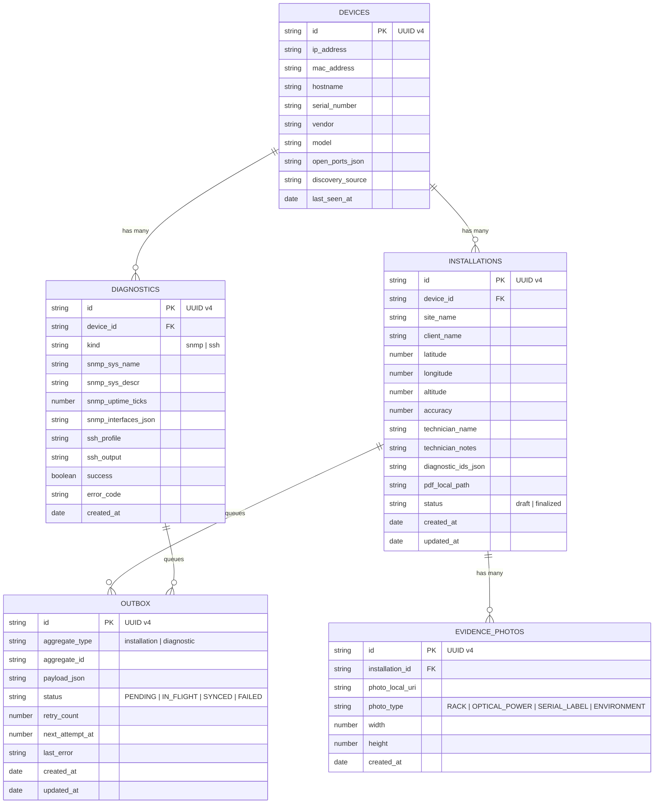
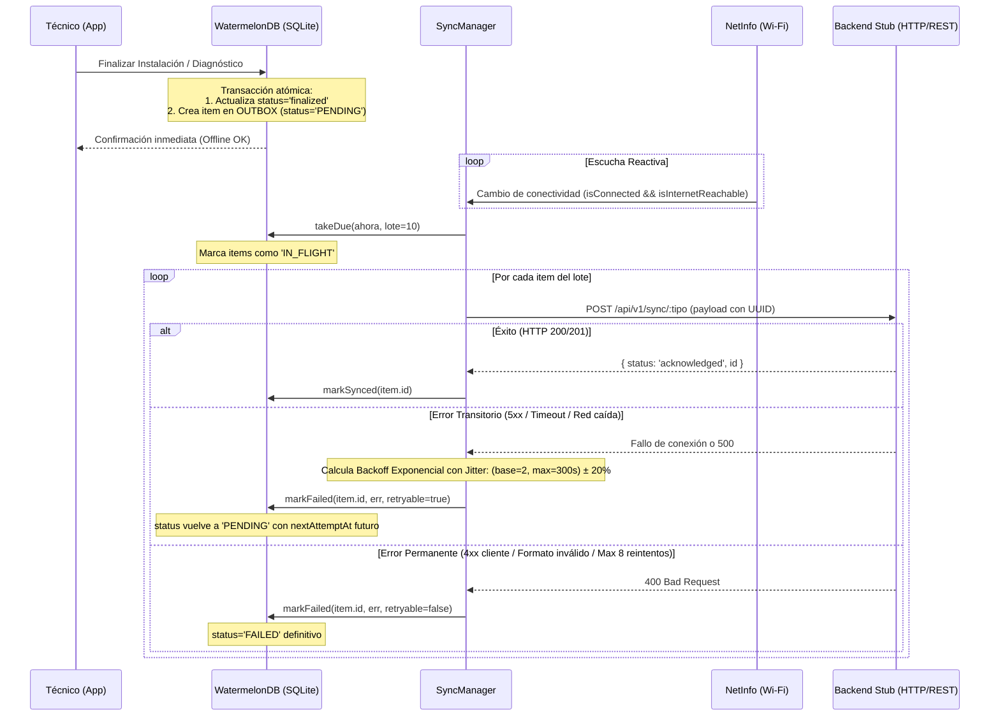

# Arquitectura Técnica — Network Diagnostics Suite (NetDiag)

## 1. Visión General de la Arquitectura

**Network Diagnostics Suite (NetDiag)** es un toolkit móvil para técnicos de campo de telecomunicaciones diseñado bajo la filosofía **Offline-First**. Su objetivo primordial es operar de manera 100% autónoma en sitios remotos sin conectividad a Internet (salas de servidores, azoteas, gabinetes urbanos), comunicándose directamente con la interfaz local de gestión del equipamiento (ONTs, Routers, Switches, Antenas) mediante sockets crudos de red y persistiendo toda la actividad en una base de datos reactiva local con sincronización diferida.

```
+-----------------------------------------------------------------------------------+
|                                CAPA DE PRESENTACIÓN                               |
|  [ScanScreen]      [SnmpScreen]      [SshScreen]      [CameraScreen] [History]    |
|  [ManualHost]      [Credentials]     [InstallForm]    [CodeScanner]  [Settings]   |
+-----------------------------------------------------------------------------------+
|                        SISTEMA DE DISEÑO Y NAVEGACIÓN                             |
|  - Tokens (Light / Dark)     - Componentes Base (Screen, Card, Badge, TerminalView)
|  - React Navigation (BottomTabs + NativeStack jerárquico tipado estrictamente)    |
+-----------------------------------------------------------------------------------+
|                            GESTIÓN DE ESTADO REACTIVO                             |
|  - scanStore (Zustand)       - settingsStore (Zustand + MMKV/SettingsRepo)       |
|  - WatermelonDB Observables (RxJS Streams directos a componentes)                 |
+-----------------------------------------------------------------------------------+
|                                CAPA DE SERVICIOS                                  |
|  +-------------------+  +--------------------+  +-------------------------------+  |
|  | DiscoveryService  |  | SnmpClient         |  | SshService (Vendor Profiles)  |  |
|  | (mDNS + TCP Pool) |  | (BER Codec + PDU)  |  | (@dylankenneally/ssh-sftp)   |  |
|  +-------------------+  +--------------------+  +-------------------------------+  |
|  +-------------------+  +--------------------+  +-------------------------------+  |
|  | LocationService   |  | PhotoService       |  | ReportService                 |  |
|  | (GPS RNF-03)      |  | (Resizer / Base64) |  | (HTML A4 -> PDF Binario)      |  |
|  +-------------------+  +--------------------+  +-------------------------------+  |
|  +-------------------+  +--------------------+  +-------------------------------+  |
|  | CredentialStore   |  | SyncManager        |  | PermissionService             |  |
|  | (Keychain Keystore|  | (Outbox + Backoff) |  | (Android Runtime Permissions) |  |
|  +-------------------+  +--------------------+  +-------------------------------+  |
+-----------------------------------------------------------------------------------+
|                           CAPA DE PERSISTENCIA LOCAL                              |
|  - Motor: WatermelonDB (SQLite con bindings C++ en Android / LokiJS en tests)      |
|  - Esquema v1: devices, diagnostics, installations, evidence_photos, outbox       |
|  - Idempotencia: Generador de UUIDs v4 para claves primarias y Outbox             |
+-----------------------------------------------------------------------------------+
|                           MÓDULOS NATIVOS Y SOCKETS                               |
|  - react-native-tcp-socket   - react-native-udp             - react-native-keychain
|  - react-native-vision-camera - @dr.pogodin/react-native-fs - react-native-share
+-----------------------------------------------------------------------------------+
```

---

## 2. Decisiones de Capas y Responsabilidades

### 2.1 Capa de Presentación (UI)
- **Tecnología:** React Native 0.88.1 Bare Workflow.
- **Enfoque:** Componentes funcionales minimalistas basados en una guía de estilos sobria (`GUIA_ESTILOS.md`) de alto contraste técnico (azul telecomunicaciones `#2F5BEA` / `#6E8BFF`, grises neutros Slate, fondos sólidos sin degradados distractores).
- **Tipografía y Legibilidad:** Fuente monoespaciada para IPs, direcciones MAC, OIDs, salidas de consola SSH y contadores de bytes.
- **Manejo de Errores Visual:** Badges de estado semántico (`UP`, `DOWN`, `SYNCED`, `PENDING`), toasts no intrusivos y estados vacíos informativos (`EmptyState`).

### 2.2 Capa de Red y Protocolos de Bajo Nivel

#### A. Descubrimiento LAN (RF-01)
1. **Detección de Subred:** Cálculo puro de red a partir de la IP local y máscara de red (restringido por seguridad y rendimiento a subredes `/24` máximo, 254 hosts).
2. **Sondeo mDNS/Bonjour:** Escucha de servicios `_http._tcp.`, `_ssh._tcp.`, `_snmp._udp.` y `_workstation._tcp.` para resolver hostnames sin necesidad de servidor DNS local.
3. **Pool de Trabajadores TCP:** Conexión concurrente limitada a 32 trabajadores simultáneos mediante sockets crudos (`react-native-tcp-socket`), escaneando puertos críticos de gestión (80, 443, 22, 23, 8291 MikroTik Winbox, 8080).
4. **Detección de Hosts Vivos:** Un host se considera activo tanto si el socket TCP conecta con éxito (`connect`) como si es rechazado explícitamente (`ECONNREFUSED`), indicando que la máquina de red existe y responde a nivel IP.
5. **Sondeo SNMP Ligero:** Como fallback para hosts que bloquean todo tráfico TCP pero admiten telemetría UDP/161, se envía un `GetRequest` ligero a `sysDescr` (OID `1.3.6.1.2.1.1.1.0`).

#### B. Cliente SNMP y Codec BER/ASN.1 Propio (RF-02)
- **Motivación:** Las librerías de NPM para SNMP existentes en React Native están desactualizadas, dependen de módulos obsoletos de Node (`dgram`, `crypto`) o arrastran dependencias incompatibles con Android.
- **Implementación:** Se construyó un parser/serializador BER completo en TypeScript puro (`src/services/snmp/ber.ts`):
  - Soporta tipos universales ASN.1: `INTEGER` (0x02), `OCTET STRING` (0x04), `NULL` (0x05), `OID` (0x06), `SEQUENCE` (0x30).
  - Soporta tipos específicos de SNMP v1/v2c (Application): `IpAddress` (0x40), `Counter32` (0x41), `Gauge32` (0x42), `TimeTicks` (0x43), `Opaque` (0x44), `Counter64` (0x46).
  - Manejo de excepciones SNMP v2c: `noSuchObject` (0x80), `noSuchInstance` (0x81), `endOfMibView` (0x82).
  - Codificación y decodificación de PDUs: `GetRequest` (0xA0), `GetNextRequest` (0xA1), `GetResponse` (0xA2).
- **Manejo de Fallback:** Al consultar un host, `SnmpClient` intenta primero SNMP v2c (soporte para contadores de 64 bits). Si el host no responde o falla, realiza un downgrade automático y transparente a SNMP v1.

#### C. Cliente SSH y Perfiles de Telecomunicaciones (RF-03)
- **Túnel Seguro:** Establecido mediante `@dylankenneally/react-native-ssh-sftp` con autenticación por usuario y contraseña recuperados exclusivamente desde el Keystore/Keychain de hardware.
- **Perfiles Cerrados (`src/services/ssh/profiles.ts`):** Para mitigar riesgos de inyección o comandos destructivos en caliente, se implementó una lista cerrada de diagnósticos por fabricante:
  - **Cisco IOS:** `show version`, `show ip interface brief`, `show interfaces status`.
  - **MikroTik RouterOS:** `/system resource print`, `/interface print stats-detail`, `/ip address print`.
  - **OpenWrt:** `cat /etc/openwrt_release`, `ip -brief address show`, `cat /proc/uptime`.
  - **Huawei VRP:** `display version`, `display interface brief`, `display ip interface brief`.
  - **Linux Genérico:** `uname -a`, `ip -s link`, `uptime`.
- **Detección Automática:** Si el dispositivo fue auditado previamente por SNMP, el analizador extrae el fabricante a partir del OID `sysDescr` y preselecciona el perfil sugerido para el técnico.
- **Seguridad Operativa:** Timeout global de conexión de 10 segundos, timeout por comando de 15 segundos, límite de salida por comando de 256 KB con truncamiento visible (`[TRUNCADO...]`) y cierre forzado de sesión en bloque `finally`.

#### D. Captura de Evidencias, Visión y GPS (RF-04, RF-05)
- **Escáner de Códigos:** `react-native-vision-camera` v5 con hook nativo de detección para códigos QR, Code-128, DataMatrix y EAN-13.
  - Normaliza automáticamente direcciones MAC a formato canónico (`aa:bb:cc:dd:ee:ff`).
  - Advierte al técnico si el número de serie escaneado ya se encuentra asignado a otro equipo en la base de datos local para evitar duplicidades en campo.
- **Geolocalización Técnica (RNF-03):** Lectura única de alta precisión vía `react-native-geolocation-service` con `enableHighAccuracy: true`, timeout de 15 segundos y validación de umbral de precisión ($\le 30\text{ m}$).
- **Compresión y Cuota de Fotos:** Redimensionamiento mediante `@bam.tech/react-native-image-resizer` (máx. 1600 px por lado, calidad JPEG 70), guardadas en directorio aislado del sandbox (`photos/<installationId>/`) con límite estricto de 12 fotos por instalación.

#### E. Motor de Reportes PDF (RF-06)
- **Generación Local:** Renderizado de plantilla HTML A4 responsive (`src/services/report/template.ts`) y compilación a archivo binario PDF mediante `react-native-html-to-pdf`.
- **Sanitización Estricta:** Función de escape HTML (`escapeHtml`) contra inyecciones de código en campos de texto libre o salidas de comandos SSH.
- **Incrustación de Evidencias:** Las fotografías se codifican a Base64 en memoria al momento de compilar el PDF para garantizar que el archivo resultante sea 100% autocontenido y no dependa de enlaces de archivos locales.

---

## 3. Arquitectura de Datos y Persistencia Offline-First

### 3.1 Modelo Relacional WatermelonDB

WatermelonDB opera sobre una base de datos relacional SQLite embebida, ofreciendo reactividad a través de Observables (RxJS) y lazy-loading para mantener la UI fluida a 60 FPS aún con miles de registros históricos.



### 3.2 Patrón Outbox y Sincronización Diferida (RF-07)



---

## 4. Seguridad de Credenciales y Manejo de Secretos

1. **Almacenamiento Físico Protegido:** Se utiliza `react-native-keychain` configurado con nivel de servicio `SECURITY_LEVEL.SECURE_HARDWARE` en Android (Keystore respaldado por hardware TEE / StrongBox). Si el dispositivo no posee procesador de seguridad, se degrada a `SECURITY_LEVEL.SECURE_SOFTWARE` con cifrado AES-256.
2. **Aislamiento por Dominios:** Cada dispositivo almacena sus credenciales en un servicio independiente en el Keystore (`netdiag.ssh.<deviceId>` y `netdiag.snmp.<deviceId>`), impidiendo colisiones entre routers del mismo operador.
3. **Prohibición Estricta de Texto Plano:** Las contraseñas, claves privadas y comunidades SNMP jamás se escriben en la base de datos WatermelonDB, ni en archivos de logs ni en AsyncStorage.
4. **Ciclo de Vida en Memoria:** Las contraseñas se recuperan puntualmente al iniciar la conexión SSH o SNMP y no se persisten en stores globales de React.

---

## 5. Backend de Sincronización (Stub de Pruebas)

El servidor stub (`backend/src/server.js`) implementa:
- **Tecnología:** Node.js, Express y SQLite (`better-sqlite3`).
- **Idempotencia Garantizada:** Los endpoints reciben el UUID generado por la aplicación móvil. Si el mismo reporte o foto se recibe múltiples veces por reintentos de red, el servidor ejecuta un `INSERT OR REPLACE / IGNORE`, respondiendo con HTTP 200 sin duplicar registros.
- **Simulador de Fallos en Terreno:**
  - `X-Simulate-Error: <codigo_http>`: Permite inyectar códigos 500, 503 o 400 desde la app o tests para validar la resiliencia del Outbox.
  - `X-Simulate-Delay: <milisegundos>`: Permite simular latencias extremas de enlaces satelitales o redes 2G rurales.
